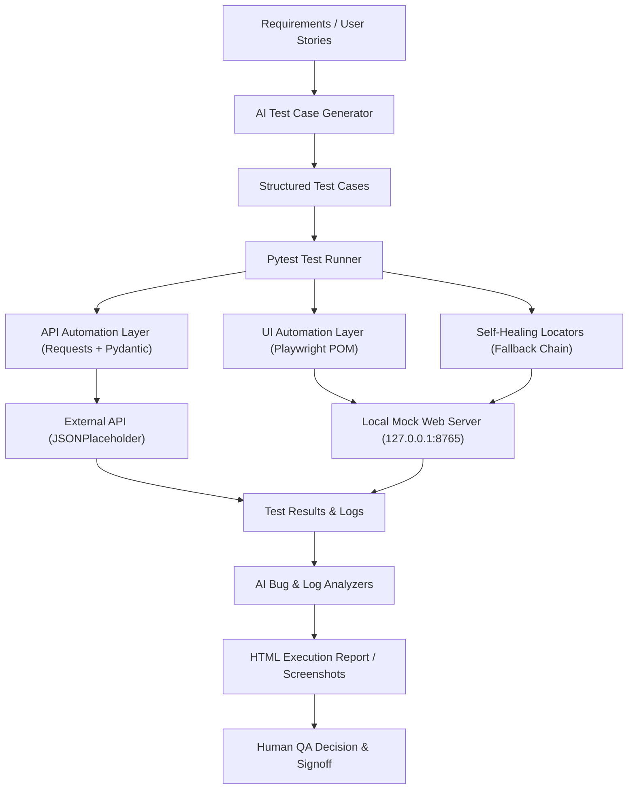

# AI-QA-Suite: AI-Powered QA Automation Framework

[](https://github.com/pavan123chinta/AI-QA-Suite-Complete/actions/workflows/ci.yml)


## 📌 Project Overview

**AI-QA-Suite** is an enterprise-structured, portfolio-grade QA automation framework designed to demonstrate practical Quality Engineering combined with AI-assisted testing capabilities.

The framework unites standard production automation tooling (**Pytest**, **Requests**, **Playwright**, and **Page Object Model**) with AI-assisted workflows for requirement test case synthesis, defect triage, multi-line log stream anomaly detection, synthetic test data generation, and resilient self-healing UI locators.

### Current Test Suite Distribution (36 Collected Tests)

The entire suite consists of **36 verified tests**, all automated and passing:

| Category | Test Count | Location | Purpose & Scope |
| :--- | :---: | :--- | :--- |
| **REST API** | **12** | `tests/api/` | Full CRUD operations (`GET`, `POST`, `PUT`, `PATCH`, `DELETE`), Pydantic schema validation, query filters, and negative HTTP 404 / route error scenarios against JSONPlaceholder. |
| **Playwright UI** | **15** | `tests/ui/` | Page Object Model (POM) flows covering landing page navigation, positive/negative login authentication, checkbox state toggling, and dynamic add/remove element operations against the local mock app server. |
| **AI Capabilities** | **8** | `tests/ai/` | Structured requirement-to-test synthesis (1), bug triage and root cause analysis (1), multi-line log stream anomaly detection (1), synthetic test data generation (1), and self-healing locator verification (4). |
| **E2E Integration** | **1** | `tests/integration/` | Complete end-to-end lifecycle: requirement ingestion ➔ AI test case synthesis ➔ API validation ➔ UI POM validation ➔ log anomaly analysis ➔ defect triage. |
| **Total Suite** | **36** | `tests/` | **36 passed** (The last verified Docker execution completed 36 tests in 19.70s). |

---

## ⚡ Quickstart (TL;DR)

Get up and running immediately using either Docker Compose or a local Python virtual environment:

### Repository Cloning
Before running installation or test commands, clone the repository and navigate into the project directory:
```bash
git clone https://github.com/pavan123chinta/AI-QA-Suite-Complete.git
cd AI-QA-Suite-Complete
```

### Option A: Run via Docker Compose (Recommended — Zero Host Configuration)
Ensure Docker Desktop is running, then execute from the project root:
```bash
docker compose up --build --abort-on-container-exit
```
*Executes all 36 tests inside an isolated Linux container (`python:3.11-slim`) and mounts the self-contained HTML report directly into `reports/report.html` on your host machine.*

### Option B: Run Locally (Python 3.10+)

#### Windows PowerShell:
```powershell
# 1. Create and activate virtual environment
python -m venv venv
.\venv\Scripts\Activate.ps1

# 2. Upgrade pip and install dependencies
python -m pip install --upgrade pip
pip install -r requirements.txt

# 3. Install Playwright browser binaries (Chromium)
python -m playwright install chromium

# 4. Execute all 36 tests with HTML report generation
python -m pytest --html=reports/report.html --self-contained-html
```

#### Windows Command Prompt (`cmd.exe`):
```cmd
python -m venv venv
venv\Scripts\activate.bat
python -m pip install --upgrade pip
pip install -r requirements.txt
python -m playwright install chromium
python -m pytest --html=reports/report.html --self-contained-html
```

#### Windows Git Bash:
```bash
python -m venv venv
source venv/Scripts/activate
python -m pip install --upgrade pip
pip install -r requirements.txt
python -m playwright install chromium
python -m pytest --html=reports/report.html --self-contained-html
```

#### macOS / Linux:
```bash
python3 -m venv venv
source venv/bin/activate
python -m pip install --upgrade pip
pip install -r requirements.txt
python -m playwright install chromium
python -m pytest --html=reports/report.html --self-contained-html
```

### Viewing the HTML Execution Report
Once execution completes, open the self-contained report in Google Chrome or your default browser:
- **Windows PowerShell**: `Start-Process "chrome.exe" "reports/report.html"` (or `Start-Process reports/report.html`)
- **Windows Command Prompt**: `start reports\report.html`
- **macOS**: `open reports/report.html`
- **Linux**: `xdg-open reports/report.html`

---

## 🚀 Key Features

### 1. Robust REST API Automation Layer
- **Client Architecture**: Clean separation between a reusable session-based HTTP client (`APIClient`) and domain service clients (`PostsClient`).
- **CRUD Operations**: Comprehensive test coverage for `GET`, `POST`, `PUT`, `PATCH`, and `DELETE` requests against standard REST resources.
- **Data Integrity & Schema Validation**: Enforces request/response data contracts using strongly-typed **Pydantic** models (`PostModel`).
- **Resilience & Security**: Centralized logging with sensitive credential masking, custom header injection, and query/path parameter handling.
- **Negative & Edge Scenarios**: Validates 404 responses for nonexistent entity IDs, unmapped route slugs, and simulated auth token headers.

### 2. Modern Playwright UI Automation & Page Object Model (POM)
- **Engine**: Microsoft Playwright for Python with built-in auto-waiting, context isolation, and Chromium support.
- **Page Object Model**: Strict encapsulation across `BasePage`, `LoginPage`, `HomePage`, `CheckboxesPage`, and `AddRemoveElementsPage`.
- **Test Isolation**: Session-scoped browser lifecycle paired with function-scoped `BrowserContext` and `Page` instances for zero state contamination.
- **Zero Hardcoded Sleeps**: Relies strictly on Playwright web-first assertions and actionability checks (visible, stable, enabled), avoiding arbitrary fixed sleep timers.
- **Failure Artifacts**: Pytest hook in `conftest.py` automatically captures full-page PNG screenshots on test failures into `reports/screenshots/`.

### 3. AI-Assisted QA Capabilities
- **Pluggable AI Provider Architecture**: Abstract base class (`AIProvider`) enforcing contracts for text and structured JSON generation.
- **Deterministic Mock AI Provider (`MockAIProvider`)**: Offline, zero-cost, rule-based intelligence engine enabled by default. Requires no external LLM API key and eliminates non-deterministic assertion failures in automated CI runs.
- **Optional External LLM Integration (`LLMProvider`)**: Supports OpenAI-compatible REST endpoints. If unconfigured, missing an API key, or unreachable, it degrades gracefully to `MockAIProvider` without breaking test runs.
- **AI Test Case Generator**: Parses requirements and user stories to produce structured test scenarios with positive, negative, boundary, and edge classifications.
- **AI Defect & Root Cause Analyzer**: Ingests error messages, stack traces, and failure logs to output failure categorization, priority triage, probable root cause, and developer investigation steps.
- **AI Log Stream Analyzer**: Evaluates multi-line application log streams to surface cascading failure chains (e.g., gateway timeouts triggering connection pool exhaustion).
- **AI Synthetic Test Data Generator**: Produces structured datasets including standard, boundary, and invalid input records.
- **Self-Healing Locator Fallback Mechanism**: Intercepts element location failures, sequentially evaluates the caller-configured list of fallback selectors, logs healing telemetry, and queries the AI provider for locator suggestions using sanitized runtime DOM context for failure triage.

### 4. CI/CD & Reporting
- **Automated CI Pipeline**: GitHub Actions workflow (`.github/workflows/ci.yml`) executes the test suite in headless mode on Ubuntu runners.
- **HTML Reporting**: Generates self-contained HTML execution reports (`reports/report.html`) with customized metadata and runtime information.
- **CI Artifact Upload**: Retains test reports and execution logs for 14 days on every workflow run.

---

## 🏗️ Architecture & Component Interaction



### Component Flow & Data Boundaries

1. **Pytest Test Organization & Lifecycle (`pytest.ini`, `conftest.py`)**:
   - Centralizes session setup and teardown.
   - Launches an in-process, threaded HTTP mock server (`MockLocalServer`) on `127.0.0.1:8765` as an `autouse=True` session fixture.
   - Manages Playwright driver lifecycle, opening a single browser process and creating fresh `BrowserContext` and `Page` objects per UI test function for strict isolation.
   - Injects failure hooks to snapshot full-page screenshots into `reports/screenshots/` when tests fail.
2. **Page Object Model (`pages/`)**:
   - `BasePage` encapsulates foundational Playwright actions (`click`, `fill`, `get_text`, `is_visible`, `wait_for_selector`) and credential masking.
   - Concrete pages (`LoginPage`, `HomePage`, `CheckboxesPage`, `AddRemoveElementsPage`) represent application views and expose domain-specific interaction methods.
3. **REST API Client Layer (`api/`)**:
   - `APIClient` wraps `requests.Session` with standardized base URL routing, timeout enforcement, request/response logging, and bearer token handling.
   - `PostsClient` provides high-level CRUD methods.
   - `PostModel` (Pydantic) enforces schema types for payloads and responses.
4. **Target Boundaries & Network Dependencies**:
   - **UI Tests**: Execute against `http://127.0.0.1:8765` served by `MockLocalServer`. **100% network-independent and deterministic.**
   - **API Tests**: Target `https://jsonplaceholder.typicode.com` by default. **Requires outbound internet access.**
   - **AI Tests**: Default to `MockAIProvider`. **Offline, zero-cost, and deterministic local execution.**

---

## 🤖 AI Layer: Deterministic Mock vs. Optional LLM

To ensure test repeatability, cost efficiency, and CI reliability, the framework separates the AI abstraction into two distinct providers:

| Dimension | Default: `MockAIProvider` | Optional: `LLMProvider` |
| :--- | :--- | :--- |
| **Engine Type** | Deterministic, rule-based heuristic synthesizer | Remote generative Large Language Model (OpenAI-compatible) |
| **Network Requirement** | 100% Offline / Local | Requires outbound internet access to remote LLM endpoint |
| **API Keys & Cost** | Zero cost, no API keys required | Requires valid API key (`LLM_API_KEY`); costs depend on token usage |
| **Execution Speed** | Fast local execution without network latency | Subject to network latency and LLM inference response times |
| **Failure Behavior** | Deterministic outputs designed to match expected test schemas | Automatically falls back to `MockAIProvider` if unconfigured or unreachable |
| **Role in Test Suite** | Default provider for local runs, CI pipelines, and automated test assertions | Evaluated for live prompt experimentation when explicitly configured |

> [!IMPORTANT]
> **Honest AI Disclosure**: The default `MockAIProvider` is an offline, rule-based mock implementation designed for predictable test automation and zero-cost CI execution. It validates prompt templates, data serialization schemas, and error fallbacks. **It does not execute a live neural network or make live API calls to OpenAI during automated test runs.**

---

## 📂 Project Directory Structure

```
AI-QA-Suite-Complete/
├── .github/
│   └── workflows/
│       └── ci.yml                  # GitHub Actions CI/CD pipeline
├── ai/
│   ├── providers/                  # AI Provider abstraction layer
│   │   ├── ai_provider.py          # Abstract Base Class (AIProvider)
│   │   ├── mock_provider.py        # Deterministic rule-based local provider
│   │   ├── llm_provider.py         # Optional external OpenAI-compatible provider
│   │   └── provider_factory.py     # Provider factory with automatic fallback logic
│   ├── prompts/                    # System and task prompt templates
│   ├── test_case_generator/        # Requirement-to-test-case synthesis
│   ├── bug_analyzer/               # Defect triage & root cause analysis
│   ├── log_analyzer/               # Multi-line log stream anomaly detection
│   ├── test_data_generator/        # Synthetic test data generation
│   └── self_healing/               # Resilient self-healing locator mechanism
├── api/
│   ├── clients/                    # APIClient & PostsClient HTTP wrappers
│   ├── endpoints/                  # Centralized endpoint route constants
│   └── models/                     # Pydantic schema validation models
├── pages/                          # Playwright Page Object Model classes
│   ├── base_page.py                # Foundational browser operations & actionability checks
│   ├── login_page.py               # Login form authentication & flash banners
│   ├── home_page.py                # Application landing page navigation
│   ├── checkboxes_page.py          # Checkbox state assertions & toggles
│   └── add_remove_elements_page.py # Dynamic element addition & removal
├── tests/                          # 36 Collected and Passing Tests
│   ├── api/                        # REST API automation tests (12 tests)
│   ├── ui/                         # Playwright browser automation tests (15 tests)
│   ├── ai/                         # AI capability & self-healing tests (8 tests)
│   └── integration/                # End-to-end AI QA lifecycle test (1 test)
├── utils/                          # Central config, logger, test data loader, mock server
├── test_data/                      # JSON datasets, sample requirements, failure logs
├── docs/                           # Architecture, UI/API guides, and interview defense
├── conftest.py                     # Session fixtures, mock app server, reporting hooks
├── pytest.ini                      # Pytest configuration, CLI flags, test markers
├── requirements.txt                # Project runtime and test dependencies
├── Dockerfile                      # Container image definition with Playwright binaries
├── docker-compose.yml              # Docker Compose test runner configuration
├── run_tests.py                    # Custom CLI runner and interactive AI demonstration script
└── README.md
```

---

## 🧪 Complete Test Execution Guide

All commands below have been **verified** against the codebase.

### 1. Full Test Suite Execution

```bash
# Local execution of all 36 tests with HTML report generation
python -m pytest --html=reports/report.html --self-contained-html

# Alternative: Execute all tests using the custom CLI runner
python run_tests.py --suite all

# Containerized execution of all 36 tests via Docker Compose
docker compose up --build --abort-on-container-exit
```
- **Expected Behavior**: Runs all 36 tests across API, UI, AI, and Integration suites. Generates `reports/report.html` and appends logs to `logs/automation.log`. All 36 tests pass with exit code `0`.

---

### 2. UI Automation Suite

UI tests execute against the embedded `MockLocalServer` on `http://127.0.0.1:8765`, which starts automatically via `conftest.py`.

#### Running UI Tests Headlessly (Default):
```bash
# Run all 15 UI tests
python -m pytest tests/ui/

# Run individual UI test modules
python -m pytest tests/ui/test_login_ui.py
python -m pytest tests/ui/test_checkboxes_ui.py
python -m pytest tests/ui/test_add_remove_elements_ui.py
```

#### Running UI Tests with a Visible (Headed) Browser:
By default, UI tests execute in headless mode (`HEADLESS=true`). To observe browser actions visibly on your desktop, launch Chromium with `HEADLESS=false` and `SLOW_MO=500` (delays interactions by 500ms for visual inspection):

**In Windows PowerShell:**
```powershell
# Run all 15 UI tests visibly
try { $env:HEADLESS="false"; $env:SLOW_MO="500"; python -m pytest tests/ui/ } finally { Remove-Item env:HEADLESS, env:SLOW_MO -ErrorAction SilentlyContinue }

# Run Login tests visibly (5 tests)
try { $env:HEADLESS="false"; $env:SLOW_MO="500"; python -m pytest tests/ui/test_login_ui.py } finally { Remove-Item env:HEADLESS, env:SLOW_MO -ErrorAction SilentlyContinue }

# Run Checkboxes tests visibly (5 tests)
try { $env:HEADLESS="false"; $env:SLOW_MO="500"; python -m pytest tests/ui/test_checkboxes_ui.py } finally { Remove-Item env:HEADLESS, env:SLOW_MO -ErrorAction SilentlyContinue }

# Run Add/Remove Elements tests visibly (5 tests)
try { $env:HEADLESS="false"; $env:SLOW_MO="500"; python -m pytest tests/ui/test_add_remove_elements_ui.py } finally { Remove-Item env:HEADLESS, env:SLOW_MO -ErrorAction SilentlyContinue }
```

**In Windows Command Prompt (`cmd.exe`):**
```cmd
set HEADLESS=false&& set SLOW_MO=500&& python -m pytest tests/ui/ & set HEADLESS=& set SLOW_MO=
```

**In Windows Git Bash:**
```bash
HEADLESS=false SLOW_MO=500 python -m pytest tests/ui/
```

**In macOS / Linux:**
```bash
HEADLESS=false SLOW_MO=500 python -m pytest tests/ui/
```

> **Note on Browser Engine**: The framework launches Playwright's bundled **Chromium** browser engine (`playwright_instance.chromium`). It does not invoke host Google Chrome unless explicitly configured via browser channel flags.

---

### 3. REST API Automation Suite

> **Note**: API tests target `https://jsonplaceholder.typicode.com`. Outbound internet connectivity is required.

```bash
# Run all 12 API tests
python -m pytest tests/api/

# Run positive CRUD tests only (8 tests)
python -m pytest tests/api/test_posts_api.py -k "TestPostsAPI"

# Run negative API tests only (404s, invalid routes, simulated auth headers) (4 tests)
python -m pytest tests/api/test_posts_api.py -m "negative"

# Execute API suite via custom CLI runner
python run_tests.py --suite api
```

---

### 4. AI Capabilities Suite

```bash
# Run all 8 AI tests (test case gen, bug analysis, log analysis, test data gen, self-healing)
python -m pytest tests/ai/

# Run individual AI capability tests
python -m pytest tests/ai/test_ai_features.py -k "test_ai_test_case_generation_from_requirement"
python -m pytest tests/ai/test_ai_features.py -k "test_ai_bug_analysis"
python -m pytest tests/ai/test_ai_features.py -k "test_ai_log_analysis"
python -m pytest tests/ai/test_ai_features.py -k "test_ai_test_data_generation"

# Run interactive AI demonstration CLI (Rich terminal UI)
python run_tests.py --demo-ai
```

---

### 5. Self-Healing Locator Tests

```bash
# Run all 4 self-healing locator tests headlessly
python -m pytest -m self_healing

# Run visible self-healing button recovery demonstration (Windows PowerShell)
try { $env:HEADLESS="false"; $env:SLOW_MO="500"; python -m pytest tests/ai/test_ai_features.py -k "test_self_healing_button_recovery" } finally { Remove-Item env:HEADLESS, env:SLOW_MO -ErrorAction SilentlyContinue }

# Shorthand for Git Bash / macOS / Linux
HEADLESS=false SLOW_MO=500 python -m pytest tests/ai/test_ai_features.py -k "test_self_healing_button_recovery"
```

---

## 🔧 Self-Healing Locator Mechanism

In UI automation, locator drift due to DOM updates and redesigns is a primary cause of pipeline flakiness. **AI-QA-Suite** implements an in-memory resilient locator strategy:

```
[Primary Locator Attempt]
         │ (Fails / Times Out)
         ▼
[Sequential Fallback Evaluation]
   └── Iterates through caller-defined fallback_locators list
         │ (e.g., fallback #1 -> fallback #2 -> fallback #N)
         │
         ├── [Element Located] ──> Record 'HEALED' telemetry & proceed
         │
         ▼ (If primary and all fallbacks fail)
[Extract Bounded & Sanitized Runtime DOM Context]
   ├── Exclude <script>, <style>, <svg>, <noscript>, <iframe>
   ├── Mask password/token fields with [REDACTED]
   ├── Mask regular input values with [SANITIZED]
   └── Clip to max 1,500 characters
         ▼
[Request AI Locator Suggestions for Failure Triage Logs]
```

### Complete 9-Step Workflow:
1. **Primary Locator Attempt**: `SelfHealingLocator.find()` attempts to resolve `primary_locator` within the specified timeout.
2. **Failure Interception**: If the primary selector fails or times out, the exception is caught, logged, and the fallback sequence begins.
3. **Ordered Fallback Evaluation**: The locator iterates sequentially through `self.fallback_locators` (the ordered list of alternate selectors supplied by the caller/page object).
4. **Successful Recovery**: As soon as a fallback selector matches and becomes visible, a `HEALED` telemetry event is recorded (including failed locator, healed locator, and strategy rank), and execution proceeds without breaking the test.
5. **Exhaustion Trigger**: If primary and all fallback locators fail, the locator queries the AI provider for locator suggestions.
6. **Runtime DOM Extraction**: In-browser JavaScript evaluates the active page to find the closest interactive container or form matching element keywords.
7. **DOM Sanitization**: Sensitive inputs (`type="password"`, names containing `pass` or `token`) are masked with `[REDACTED]`, while other input values are set to `[SANITIZED]`. Unneeded tags (`<script>`, `<style>`, `<svg>`, `<noscript>`, `<iframe>`) are stripped.
8. **Bounded Context**: Extracted HTML is normalized and strictly bounded to **1,500 characters** with an explicit truncation indicator to avoid prompt bloat.
9. **Graceful Degradation on Inaccessible Pages**: If the browser page is detached or closed, a safe placeholder comment is returned, preventing secondary crashes and ensuring the original failure details are preserved.

> [!CAUTION]
> **Practical Scope & Limitations**:
> - **In-Memory Resilient Execution**: The self-healing locator recovers element interactions in memory to prevent false-alarm test failures during test execution. It **does not** autonomously rewrite application source code or page object files on disk without human review.
> - **Sanitization Boundaries**: The sanitizer explicitly redacts form control values and sensitive attributes. It should not be assumed to catch every conceivable piece of arbitrary sensitive text embedded in raw markup.
> - **Heuristic Limitations**: Self-healing is designed for localized element mutation; it cannot recover interactions if the target functional feature has been removed entirely from the application.

---

## 📊 HTML Reports & Failure Debugging

### Generating Reports
Pytest produces a standalone, self-contained HTML report bundling all styles, tables, and scripts into a single file:
```bash
python -m pytest --html=reports/report.html --self-contained-html
```

### Opening the Report
- **Windows PowerShell**:
  ```powershell
  # Open in Google Chrome explicitly:
  Start-Process "chrome.exe" "reports/report.html"
  # Or in default browser:
  Start-Process reports/report.html
  ```
- **Windows Command Prompt (`cmd.exe`)**:
  ```cmd
  start reports\report.html
  ```
- **macOS**: `open reports/report.html`
- **Linux**: `xdg-open reports/report.html`

### Docker Host Volume Mounting
The container runner in `docker-compose.yml` mounts the host's `./reports` and `./logs` directories:
```yaml
volumes:
  - ./reports:/app/reports
  - ./logs:/app/logs
```
When `docker compose up --build --abort-on-container-exit` executes, the resulting `reports/report.html` and `logs/automation.log` are written directly to your host workspace and are immediately viewable.

### What to Inspect in the Report:
- **Environment Metadata**: Injected by `pytest_configure` in `conftest.py` (Project Name, Python version, Architecture, Default AI Provider).
- **Execution Metrics**: Exact runtime duration, passed test count (**36**), failed count (**0**), and individual test duration.
- **Automated Failure Screenshots**: If a UI test fails, the custom hook in `conftest.py` automatically captures a full-page PNG into `reports/screenshots/FAILED_<test_name>.png` and links it in the execution logs.
- **Central Logs**: Inspect `logs/automation.log` for rotating multi-level logs capturing HTTP request payloads, self-healing telemetry events, and AI prompt exchanges.

---

## 🎯 Professional Interview Demonstration Guide (15–20 Minutes)

This workflow is organized specifically for live technical interviews (Senior QA Automation Engineer, SDET, or AI-QA Engineer).

### Stage 1: Project Introduction & Architecture (3 Minutes)
- **Problem Statement**: Standard test suites are fragile against UI locator drift and require manual triage for defect analysis and log anomaly investigation. This project combines robust production testing (Playwright + Requests + Pytest) with structured AI assistance.
- **Code Walkthrough**:
  - Open and show [conftest.py](conftest.py) (test lifecycle, mock server auto-start, failure screenshot hook).
  - Open and show [pages/base_page.py](pages/base_page.py) and [pages/login_page.py](pages/login_page.py) (POM architecture, Playwright auto-waiting, credential masking).
  - Open and show [api/clients/api_client.py](api/clients/api_client.py) and [api/models/post_model.py](api/models/post_model.py) (session management, Pydantic contract validation).
  - Open and show [ai/providers/provider_factory.py](ai/providers/provider_factory.py) (clean provider abstraction and fallback logic).

---

### Stage 2: AI Feature Demonstration (2 Minutes)
Demonstrate the AI capabilities in the terminal:
```bash
python run_tests.py --demo-ai
```
- **Key Talking Points**:
  - Showcase the formatted Rich tables for requirement-to-test-case synthesis (positive, negative, boundary, edge).
  - Highlight the AI defect triage output (probable root cause, suggested priority P1–P4, recommended additional tests).
  - Point out multi-line log stream anomaly detection identifying cascading server failures.
  - **Honest Explanation**: Clarify that this demonstration runs locally using `MockAIProvider`, delivering fast, deterministic results without external API keys or token costs. Mention that `LLMProvider` is also implemented for optional OpenAI connectivity.

---

### Stage 3: Visible Playwright Browser Demonstration (4 Minutes)
Showcase visible browser automation:

**In Windows PowerShell:**
```powershell
try { $env:HEADLESS="false"; $env:SLOW_MO="500"; python -m pytest tests/ui/test_login_ui.py } finally { Remove-Item env:HEADLESS, env:SLOW_MO -ErrorAction SilentlyContinue }
```

**Shorthand in Git Bash / macOS / Linux:**
```bash
HEADLESS=false SLOW_MO=500 python -m pytest tests/ui/test_login_ui.py
```

- **Key Talking Points**:
  - Point out that Chromium opens on screen, navigates to the local mock app server (`127.0.0.1:8765`), types credentials, verifies flash messages, and logs out.
  - Emphasize **Playwright web-first assertions**: elements are automatically checked for actionability (visible, stable, enabled) without arbitrary `time.sleep()` calls.
  - Explain **browser context isolation**: each test gets a clean `BrowserContext` with isolated cookies and local storage.

---

### Stage 4: Self-Healing Locator Deep-Dive (4 Minutes)
Demonstrate resilient element recovery live:

**In Windows PowerShell:**
```powershell
try { $env:HEADLESS="false"; $env:SLOW_MO="500"; python -m pytest tests/ai/test_ai_features.py -k "test_self_healing_button_recovery" } finally { Remove-Item env:HEADLESS, env:SLOW_MO -ErrorAction SilentlyContinue }
```

**Shorthand in Git Bash / macOS / Linux:**
```bash
HEADLESS=false SLOW_MO=500 python -m pytest tests/ai/test_ai_features.py -k "test_self_healing_button_recovery"
```

- **Key Talking Points**:
  - Point out what happened: the test deliberately used a broken primary locator (`#non-existent-button-id-xyz`).
  - Explain the fallback sequence: it caught the timeout, attempted `button.non-existent-class`, recovered on `button[type='submit']`, logged a `HEALED` telemetry event, and completed the login.
  - Explain the runtime DOM extraction: if all fallbacks fail, it extracts bounded runtime DOM context (up to 1,500 chars), redacts sensitive password fields with `[REDACTED]`, and requests AI recommendations for failure triage logs.

---

### Stage 5: API Automation Demonstration (2 Minutes)
Execute the API suite:
```bash
python -m pytest tests/api/
```
- **Key Talking Points**:
  - 12 tests validating CRUD operations against REST resources.
  - Point out `PostModel` (Pydantic) validating response structure and types.
  - Highlight negative test scenarios validating 404 responses for nonexistent entity IDs and unmapped routes.
  - Mention that API tests target JSONPlaceholder and require internet connectivity.

---

### Stage 6: Docker & Complete Suite Execution (2–3 Minutes)
Run the entire containerized test suite:
```bash
docker compose up --build --abort-on-container-exit
```
- **Key Talking Points**:
  - Demonstrates containerization best practices: runs in an isolated `python:3.11-slim` container with Playwright system libraries.
  - Point out that all **36 tests pass in ~20 seconds**.
  - Highlight volume mounting: `./reports:/app/reports` ensures reports and logs are instantly accessible on the host.

---

### Stage 7: HTML Test Report Review (1–2 Minutes)
Open the generated report:
```powershell
Start-Process "chrome.exe" "reports/report.html"
```
- **Key Talking Points**:
  - Walk the interviewer through the custom metadata header (Project, Architecture, Default Provider).
  - Show the 36 passed tests, zero failures, and execution timings.
  - Explain that on test failure, full-page screenshots are automatically captured and linked.

---

## 💡 Interview Technical Talking Points

Quick reference for technical deep-dive questions during Senior QA / SDET interviews:

1. **Why Pytest?**
   - Fixture dependency injection system with clean scoping (`session`, `function`), parameterization (`@pytest.mark.parametrize`), built-in assertion introspection, and an extensive plugin ecosystem (`pytest-html`).
2. **Why Playwright over Selenium?**
   - Built-in auto-waiting eliminates arbitrary `time.sleep()` statements. Fast, lightweight `BrowserContext` isolation allows clean sessions within a single browser process. Native Chromium, Firefox, and WebKit support with network interception capabilities.
3. **Why Page Object Model (POM)?**
   - Decouples test logic from DOM representation. If an application UI changes, only the corresponding Page Object selector or method needs updating, preventing cascading test failures.
4. **How Pytest Fixtures Support Setup and Teardown:**
   - Yield fixtures (`mock_app_server`, `browser`, `page`) run initialization before the `yield` and guarantee teardown cleanup afterward, even if assertions fail.
5. **How API Automation is Structured:**
   - Two-tier architecture: generic session-level client (`APIClient`) handles base routing, headers, logging, and timeouts; domain-specific client (`PostsClient`) models business endpoints.
6. **Positive vs. Negative API Testing:**
   - Positive tests validate 200/201 status codes, response headers, and valid payload schemas. Negative tests validate graceful handling of 404s, invalid route slugs, and simulated auth token tampering.
7. **Role of Pydantic in API Testing:**
   - Provides runtime data contract validation. If the backend changes a field type (e.g., `userId` returns a string instead of an integer), Pydantic raises a validation error immediately.
8. **Why Use an Embedded Mock Web Server?**
   - Running `MockLocalServer` ensures UI tests run 100% offline, deterministically, and free of flakiness from third-party hosting latency or downtime.
9. **AI Provider Abstraction Design:**
   - Adheres to the Dependency Inversion Principle. An abstract base class (`AIProvider`) enforces `generate_text` and `generate_structured_json`. The application code does not care whether responses come from `MockAIProvider` or `LLMProvider`.
10. **Value of the Self-Healing Locator Approach:**
    - Prevents pipeline flakiness from minor DOM shifts by evaluating resilient fallback selectors in-memory, while capturing actionable triage data for permanent engineering fixes.
11. **Runtime DOM Capture & Sanitization:**
    - Grabs the relevant parent container matching element keywords, excludes unneeded tags (`script`, `style`, `svg`, `noscript`, `iframe`), redacts passwords with `[REDACTED]`, sanitizes input values with `[SANITIZED]`, and bounds output to 1,500 characters.
12. **Value of Containerization with Docker Compose:**
    - Solves "works on my machine" issues by packaging the Linux OS, Python runtime, system libraries, browser binaries, and test suite into a single reproducible image.
13. **HTML Reports in CI/CD:**
    - Self-contained HTML reports enable instant sharing across QA, developers, and product managers without requiring external report servers.
14. **Realistic Future Enhancements:**
    - *Existing*: Static fallback chains, mock app server, and rule-based heuristic AI.
    - *Planned Future Enhancements*: Offline API mock server (e.g., via `responses` or WireMock), visual regression testing with Playwright pixel snapshot comparisons, and vector-database embeddings for historical DOM similarity matching.

---

## ✅ Interview Preparation Checklist

Follow this checklist before starting an interview or demonstration:

- [ ] **Open Project in IDE**: Open `AI-QA-Suite-Complete` in VS Code / Antigravity / PyCharm.
- [ ] **Check Git Status**: Confirm git status is clean (`git status --short`).
- [ ] **Activate Python Virtual Environment**: Run `.\venv\Scripts\Activate.ps1` (or your OS equivalent).
- [ ] **Confirm Dependencies**: Verify `pip list` shows `pytest`, `playwright`, `pydantic`, `requests`, and `rich`.
- [ ] **Confirm Playwright Chromium**: Ensure Chromium is installed (`python -m playwright install chromium`).
- [ ] **Confirm Docker Engine**: If demonstrating Docker, verify Docker Desktop is running (`docker info`).
- [ ] **Verify Internet Connection**: Confirm outbound connectivity for JSONPlaceholder API tests.
- [ ] **Dry Run AI Demo**: Execute `python run_tests.py --demo-ai` to ensure Rich output renders cleanly.
- [ ] **Dry Run Visible UI Test**: Execute visible login test to verify browser launch.
- [ ] **Dry Run Full Suite**: Execute `python -m pytest` and confirm **36/36 tests pass**.
- [ ] **Inspect HTML Report**: Open `reports/report.html` and verify the timestamp and test count.
- [ ] **Ready Architectural Defense**: Be prepared to explain the honest distinction between `MockAIProvider` and `LLMProvider`.

### Recommended Live Demonstration Order:
1. **Architecture Walkthrough** (Show `conftest.py`, `BasePage`, `APIClient`).
2. **AI CLI Demo** (`python run_tests.py --demo-ai`).
3. **Visible UI Automation** (`HEADLESS=false SLOW_MO=500 python -m pytest tests/ui/test_login_ui.py` or PowerShell equivalent).
4. **Self-Healing Recovery** (`HEADLESS=false SLOW_MO=500 python -m pytest tests/ai/test_ai_features.py -k "test_self_healing_button_recovery"` or PowerShell equivalent).
5. **API Automation** (`python -m pytest tests/api/`).
6. **Docker Compose Suite** (`docker compose up --build --abort-on-container-exit`).
7. **HTML Report Review** (`Start-Process reports/report.html`).

---

## 🛠️ Troubleshooting

| Issue | Root Cause | Solution |
| :--- | :--- | :--- |
| `TargetClosedError` or Playwright launch failure | Playwright browser binaries are not installed | Run `python -m playwright install chromium` in your active virtual environment. |
| API tests fail with connection timeouts | No outbound internet connectivity to `jsonplaceholder.typicode.com` | Check your internet connection or verify DNS resolution. |
| UI tests fail to connect to `127.0.0.1:8765` | Port 8765 is occupied or previous process was interrupted | Ensure no orphaned Python processes are bound to port 8765. The session fixture starts automatically in `conftest.py`. |
| `ModuleNotFoundError: No module named 'utils'` / `pages` | Python path does not include the project root | Execute pytest using `python -m pytest` from the project root directory rather than running bare `pytest` in subfolders. |
| PowerShell script activation error (`execution of scripts is disabled`) | Windows PowerShell Execution Policy restricts running scripts | Run `Set-ExecutionPolicy -Scope Process -ExecutionPolicy Bypass` in your active session, or activate via CMD (`venv\Scripts\activate.bat`). |

---

## 📚 Documentation Reference Links
- [Architectural Design Guide](docs/architecture.md): In-depth component architecture, data flows, and design principles.
- [AI Capabilities Guide](docs/ai_features.md): Detailed workflows for test generation, defect triage, and log analysis.
- [API Testing Guide](docs/api_testing.md): REST client layering, Pydantic schemas, and endpoint registry.
- [UI Testing Guide](docs/ui_testing.md): Page Object Model architecture, Playwright fixtures, and failure hooks.
- [Interview Defense Guide](docs/interview_explanation.md): Elevator pitches, design rationale, and model interview Q&A.
