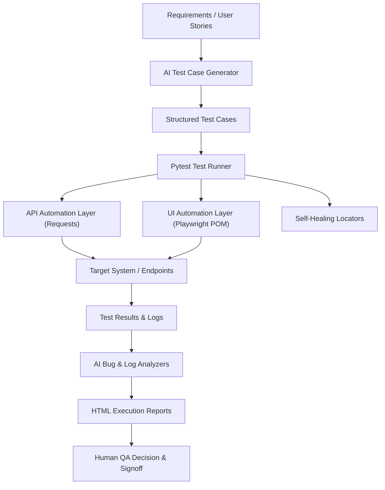

# AI-QA-Suite: AI-Powered QA Automation Framework

[](https://github.com/chint/AI-QA-Suite/actions)


## 📌 Project Overview
**AI-QA-Suite** is a professional, portfolio-grade **AI-Augmented QA Automation Framework** designed to demonstrate the career progression from QA Engineer ➔ Automation Engineer ➔ AI-Powered QA Engineer ➔ AI Engineer.

The suite combines industry-standard enterprise automation practices (Pytest, Requests, Playwright, Page Object Model) with practical, deterministic AI capabilities for test generation, failure diagnosis, log stream analysis, synthetic data creation, and self-healing locators.

---

## 🚀 Key Features

### 1. Robust API Automation Layer
- **Engine**: Python `requests` wrapped in a reusable `APIClient` and domain `PostsClient`.
- **Operations**: Full CRUD validation (`GET`, `POST`, `PUT`, `PATCH`, `DELETE`).
- **Validation**: Status code assertions, Pydantic schema validation, header sanitization, query/path parameters, and negative scenario testing (e.g. 404 handling, invalid payload rejection).

### 2. Modern UI Automation & Page Object Model (POM)
- **Engine**: Microsoft `Playwright` with Python.
- **Architecture**: Strict Page Object Model (`BasePage`, `LoginPage`, `HomePage`).
- **Resilience**: Explicit condition waits, isolated browser contexts, failure hooks with automatic full-page screenshot capture.

### 3. AI-Assisted QA Capabilities (100% Free / Local Default)
- **AI Provider Abstraction (`AIProvider`)**: Seamless interface with automatic fallback from external LLMs to deterministic, zero-cost `MockAIProvider`.
- **AI Test Case Generator**: Ingests user stories and acceptance criteria to generate structured, prioritized test suites (Positive, Negative, Boundary, Edge).
- **AI Bug & Root Cause Analyzer**: Ingests error messages, stack traces, and failure logs to output failure category, severity/priority triage, root cause diagnosis, and developer investigation steps.
- **AI Log Stream Analyzer**: Analyzes multi-line system logs for error cascades, timeouts, and resource bottlenecks.
- **AI Synthetic Test Data Generator**: Produces realistic, structured datasets for boundary testing.
- **Self-Healing Locator Demonstration**: Multi-strategy fallback chain (ID ➔ data-testid ➔ Role/Text ➔ XPath) with AI locator suggestion triage when selectors change.

### 4. CI/CD & Containerization
- **Docker**: Self-contained `Dockerfile` and `docker-compose.yml` installing all browser runtime dependencies.
- **GitHub Actions**: Fully configured `.github/workflows/ci.yml` pipeline running headless test suites and publishing HTML report artifacts on every push/PR.

---

## 🏗️ Architecture & Component Interaction



---

## 📂 Project Directory Structure

```
AI-QA-Suite-Complete/
├── .github/
│   └── workflows/
│       └── ci.yml                 # GitHub Actions CI/CD pipeline
├── ai/
│   ├── providers/                 # AI Provider abstraction layer
│   │   ├── ai_provider.py         # Abstract Base Class
│   │   ├── mock_provider.py       # Deterministic zero-cost local provider
│   │   ├── llm_provider.py        # External OpenAI/compatible provider
│   │   └── provider_factory.py    # Provider factory
│   ├── prompts/                   # Structured prompt templates
│   ├── test_case_generator/       # AI requirement-to-testcase generator
│   ├── bug_analyzer/              # AI defect & root cause triage
│   ├── log_analyzer/              # AI multi-line log anomaly analyzer
│   ├── test_data_generator/       # AI synthetic test data synthesis
│   └── self_healing/              # Resilient fallback locators
├── api/
│   ├── clients/                   # APIClient & PostsClient wrappers
│   ├── endpoints/                 # REST endpoint registry
│   └── models/                    # Pydantic schema validation models
├── pages/                         # Playwright Page Object Model classes
│   ├── base_page.py
│   ├── login_page.py
│   ├── home_page.py
│   ├── checkboxes_page.py
│   └── add_remove_elements_page.py
├── tests/
│   ├── api/                       # REST API automation tests
│   ├── ui/                        # Playwright browser automation tests
│   ├── ai/                        # AI feature tests & self-healing demo
│   └── integration/               # End-to-end AI QA lifecycle test
├── utils/                         # Central config, logger, test data loader
├── test_data/                     # JSON datasets, sample requirements, logs
├── docs/                          # Comprehensive architecture & interview guides
├── conftest.py                    # Central Pytest fixtures & reporting hooks
├── pytest.ini                     # Pytest configuration & markers
├── requirements.txt               # Dependencies
├── Dockerfile                     # Docker container configuration
├── docker-compose.yml             # Docker compose runner
├── run_tests.py                   # Interactive CLI & Test Suite runner
└── README.md
```

---

## ⚡ Quick Start & Installation

### 1. Prerequisites
- Python 3.10+ (Tested with 3.11, 3.12, 3.13)
- Git

### 2. Environment Setup
```bash
# Clone the repository
git clone https://github.com/your-username/AI-QA-Suite.git
cd AI-QA-Suite

# Create and activate virtual environment
python -m venv venv
# On Windows:
.\venv\Scripts\activate
# On Linux/macOS:
source venv/bin/activate

# Install dependencies
python -m pip install -r requirements.txt

# Install Playwright browser binaries
python -m playwright install chromium
```

### 3. Configuration
Copy `.env.example` to `.env` (optional, defaults work out of the box with zero cost):
```bash
cp .env.example .env
```

---

## 🧪 Test Execution Commands

### Run Full Test Suite
```bash
python -m pytest
```

### Run with HTML Report Generation
```bash
python -m pytest --html=reports/report.html --self-contained-html
```

### Run Specific Test Suites
```bash
# Run API tests only
python -m pytest tests/api/

# Run UI tests only (headless)
python -m pytest tests/ui/

# Run AI feature tests only
python -m pytest tests/ai/

# Run Self-Healing Locator demonstration
python -m pytest -m self_healing

# Run Smoke suite
python -m pytest -m smoke
```

### Running UI Tests with a Visible Browser

By default, UI tests execute in headless mode. You can run tests with a visible Chromium browser window and slowed execution for demonstration and visual debugging:

1. Standard headless UI test execution:
   ```bash
   pytest -v tests/ui/
   ```

2. Visible browser execution in Git Bash on Windows:
   ```bash
   HEADLESS=false SLOW_MO=500 pytest -v tests/ui/
   ```

- `HEADLESS=false` temporarily overrides the default browser mode to make the browser visible during test runs.
- `SLOW_MO=500` slows interactions by 500ms between actions for demonstration purposes.
- Note: The UI test suite currently contains 15 tests, but the test count may not remain fixed as tests are added or updated.

### Interactive CLI Runner & AI Demo
```bash
# Launch interactive AI feature demonstration
python run_tests.py --demo-ai

# Run full suite via CLI runner
python run_tests.py --suite all
```

---

## 🐳 Docker Execution

```bash
# Build Docker image
docker build -t ai-qa-suite .

# Run containerized test suite
docker run --rm -v ${PWD}/reports:/app/reports ai-qa-suite
```

---

## 🤖 AI Provider Strategy (Zero-Cost Design)
To ensure accessibility and deterministic CI/CD execution without financial cost:
1. **Default Mode (`AI_PROVIDER=mock`)**: 100% offline, free, deterministic rule-based synthesis. All AI tests pass locally and in GitHub Actions without API keys.
2. **External LLM Mode (`AI_PROVIDER=llm`)**: Optional integration with OpenAI-compatible APIs via `LLM_API_KEY`. If the key is omitted or the network fails, the framework automatically degrades gracefully to the Mock provider without failing test runs.

---

## 📊 Documentation Links
- [Architecture](docs/architecture.md)
- [Interview Explanation](docs/interview_explanation.md)
