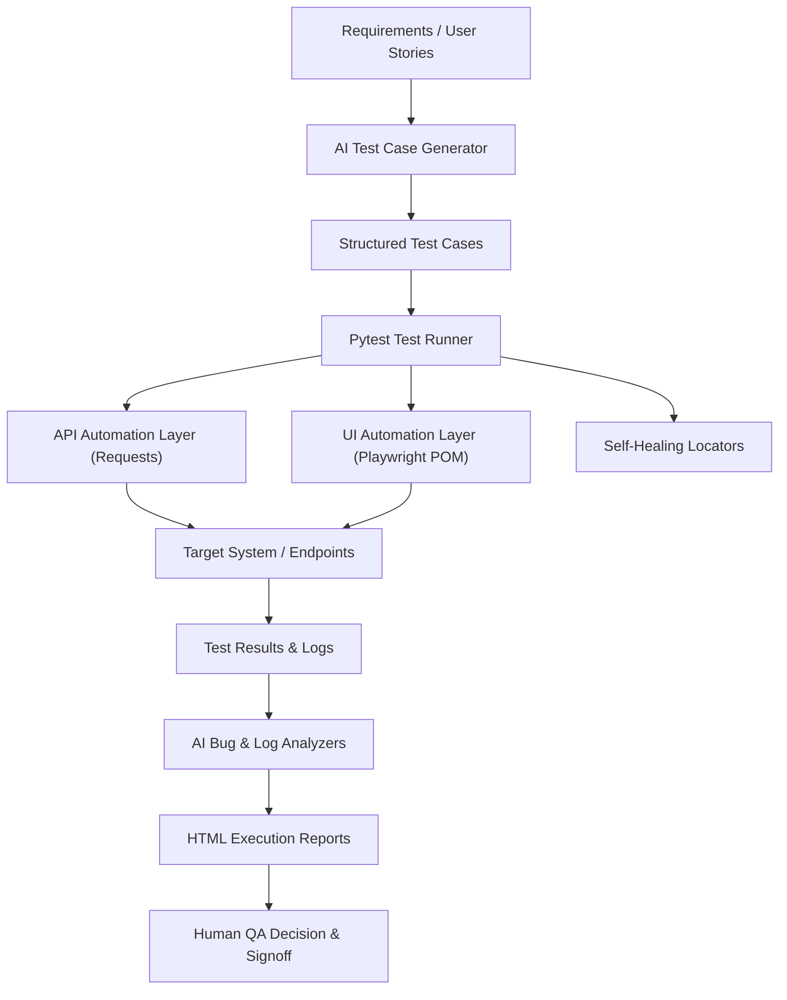

# AI-QA-Suite: AI-Powered QA Automation Framework

[](https://github.com/pavan123chinta/AI-QA-Suite-Complete/actions/workflows/ci.yml)


## 📌 Project Overview
**AI-QA-Suite** is an enterprise-structured, portfolio-grade QA automation framework designed to demonstrate practical Quality Engineering combined with AI-assisted testing capabilities.

The framework unites standard automation tooling (**Pytest**, **Requests**, **Playwright**, and **Page Object Model**) with deterministic AI-assisted capabilities for requirement test case synthesis, defect triage, multi-line log anomaly detection, synthetic test data generation, and self-healing UI locators.

---

## 🚀 Key Features

### 1. Robust REST API Automation Layer
- **Client Architecture**: Clean separation between a reusable session-based HTTP client (`APIClient`) and domain service clients (`PostsClient`).
- **CRUD Operations**: Comprehensive test coverage for `GET`, `POST`, `PUT`, `PATCH`, and `DELETE` requests against standard REST resources.
- **Data Integrity & Schema Validation**: Enforces request/response data contracts using strongly-typed **Pydantic** models (`PostModel`).
- **Resilience & Security**: Centralized logging with sensitive credential masking, custom header injection, and query/path parameter handling.
- **Negative & Edge Scenarios**: Validates 404 responses for nonexistent entity IDs and unmapped route slugs.

### 2. Modern Playwright UI Automation & Page Object Model (POM)
- **Engine**: Microsoft Playwright for Python with built-in auto-waiting and Chromium support.
- **Page Object Model**: Strict encapsulation across `BasePage`, `LoginPage`, `HomePage`, `CheckboxesPage`, and `AddRemoveElementsPage`.
- **Test Isolation**: Session-scoped browser lifecycle paired with function-scoped `BrowserContext` and `Page` instances for zero state contamination.
- **Failure Artifacts**: Pytest hook in `conftest.py` automatically captures full-page PNG screenshots on test failures into `reports/screenshots/`.

### 3. AI-Assisted QA Capabilities
- **Pluggable AI Provider Architecture**: Abstract base class (`AIProvider`) enforcing contracts for text and structured JSON generation.
- **Deterministic Mock AI Provider (`MockAIProvider`)**: Offline, zero-cost, rule-based intelligence engine enabled by default. Requires no external LLM API key and eliminates non-deterministic assertion failures.
- **Optional External LLM Integration (`LLMProvider`)**: Supports OpenAI-compatible REST endpoints. If unconfigured, missing an API key, or unreachable, it degrades gracefully to `MockAIProvider` without breaking test runs.
- **AI Test Case Generator**: Parses requirements and user stories to produce structured test scenarios with positive, negative, boundary, and edge classifications.
- **AI Defect & Root Cause Analyzer**: Ingests error messages, stack traces, and failure logs to output failure categorization, priority triage, probable root cause, and developer investigation steps.
- **AI Log Stream Analyzer**: Evaluates multi-line application log streams to surface cascading failure chains (e.g., gateway timeouts triggering connection pool exhaustion).
- **AI Synthetic Test Data Generator**: Produces structured datasets including standard, boundary, and invalid input records.
- **Self-Healing Locator Fallback Mechanism**: Intercepts element location failures, executes an ordered fallback chain (`ID` ➔ `data-testid` ➔ `Role/Text` ➔ `XPath`), logs healing telemetry, and queries the AI provider for long-term locator recommendations.

### 4. CI/CD & Reporting
- **Automated CI Pipeline**: GitHub Actions workflow (`.github/workflows/ci.yml`) executes the test suite in headless mode on Ubuntu runners.
- **HTML Reporting**: Generates self-contained HTML execution reports (`reports/report.html`) with customized metadata.
- **CI Artifact Upload**: Retains test reports and execution logs for 14 days on every workflow run.

---

## 🏗️ Architecture & Component Interaction



### Component Flow & Data Boundaries
1. **API Suite Boundary**: Tests in `tests/api/` target external endpoints (**JSONPlaceholder** by default). These require outbound internet access unless reconfigured to point to an internal or mock endpoint.
2. **UI Suite Boundary**: Tests in `tests/ui/` execute against an embedded local HTTP server (`MockLocalServer` on `127.0.0.1:8765`), making UI test execution self-contained, deterministic, and network-independent.
3. **AI Layer Boundary**: AI analysis and test generation fixtures default to `MockAIProvider`, operating locally without external network dependencies, token consumption, or LLM API keys.

---

## 🤖 AI Layer: Deterministic Mock vs. Optional LLM

To ensure test repeatability and CI reliability, it is critical to distinguish between the two provider modes:

| Dimension | Default: `MockAIProvider` | Optional: `LLMProvider` |
| :--- | :--- | :--- |
| **Engine Type** | Deterministic, rule-based heuristic synthesizer | Remote generative Large Language Model |
| **Network Requirement** | 100% Offline / Local | Requires outbound internet access to LLM endpoint |
| **API Keys & Cost** | Zero cost, no API keys required | Requires valid API key (`LLM_API_KEY`); costs depend on provider and account plan |
| **Execution Speed** | Sub-millisecond instant execution | Subject to network latency and LLM inference time |
| **Failure Behavior** | Deterministic outputs matching test schemas | Automatically falls back to `MockAIProvider` on failure |
| **Role in Test Suite** | Default provider for local runs, CI pipeline, and automated tests | Evaluated for live prompt experimentation when configured |

> **Important**: The default `MockAIProvider` is an offline, rule-based mock implementation designed for predictable test automation and zero-cost CI execution. It is not an embedded neural network or local LLM weight runner.

---

## 📂 Project Directory Structure

```
AI-QA-Suite-Complete/
├── .github/
│   └── workflows/
│       └── ci.yml                  # GitHub Actions CI/CD pipeline
├── ai/
│   ├── providers/                  # AI Provider abstraction layer
│   │   ├── ai_provider.py          # Abstract Base Class (AIProvider)
│   │   ├── mock_provider.py        # Deterministic rule-based local provider
│   │   ├── llm_provider.py         # Optional external OpenAI-compatible provider
│   │   └── provider_factory.py     # Provider factory with fallback logic
│   ├── prompts/                    # System and task prompt templates
│   ├── test_case_generator/        # Requirement-to-test-case synthesis
│   ├── bug_analyzer/               # Defect triage & root cause analysis
│   ├── log_analyzer/               # Multi-line log anomaly detection
│   ├── test_data_generator/        # Synthetic test data generation
│   └── self_healing/               # Self-healing locator fallback strategy
├── api/
│   ├── clients/                    # APIClient & PostsClient wrappers
│   ├── endpoints/                  # Centralized endpoint route constants
│   └── models/                     # Pydantic schema validation models
├── pages/                          # Playwright Page Object Model classes
│   ├── base_page.py                # Foundational browser operations & explicit waits
│   ├── login_page.py               # Login form authentication & flash banners
│   ├── home_page.py                # Application landing page navigation
│   ├── checkboxes_page.py          # Checkbox state assertions & toggles
│   └── add_remove_elements_page.py # Dynamic element addition & removal
├── tests/
│   ├── api/                        # REST API automation tests (12 tests)
│   ├── ui/                         # Playwright browser automation tests (15 tests)
│   ├── ai/                         # AI capability & self-healing tests (5 tests)
│   └── integration/                # End-to-end AI QA lifecycle test (1 test)
├── utils/                          # Central config, logger, test data loader, mock server
├── test_data/                      # JSON datasets, sample requirements, failure logs
├── docs/                           # Architecture, UI/API guides, and interview defense
├── conftest.py                     # Session fixtures, browser setup, reporting hooks
├── pytest.ini                      # Pytest configuration, CLI flags, test markers
├── requirements.txt                # Project runtime and test dependencies
├── Dockerfile                      # Container image definition with Playwright binaries
├── docker-compose.yml              # Docker Compose test runner configuration
├── run_tests.py                    # CLI runner and interactive AI demonstration script
└── README.md
```

---

## ⚡ Quick Start & Installation

### 1. Prerequisites
- **Python**: 3.10+ (Supported on 3.11, 3.12, 3.13)
- **Git**
- **Supported Platforms**: Windows, Linux, macOS

### 2. Clone & Environment Setup

#### On Windows (Command Prompt / PowerShell):
```powershell
# Clone repository
git clone https://github.com/pavan123chinta/AI-QA-Suite-Complete.git
cd AI-QA-Suite-Complete

# Create virtual environment
python -m venv venv

# Activate virtual environment
.\venv\Scripts\activate

# Upgrade pip & install dependencies
python -m pip install --upgrade pip
pip install -r requirements.txt

# Install Playwright browser binaries
python -m playwright install chromium
```

#### On Windows (Git Bash) / macOS / Linux:
```bash
# Clone repository
git clone https://github.com/pavan123chinta/AI-QA-Suite-Complete.git
cd AI-QA-Suite-Complete

# Create virtual environment
python -m venv venv

# Activate virtual environment
source venv/bin/activate  # In Git Bash on Windows: source venv/Scripts/activate

# Upgrade pip & install dependencies
python -m pip install --upgrade pip
pip install -r requirements.txt

# Install Playwright browser binaries
python -m playwright install chromium
```

### 3. Environment Configuration
Copy `.env.example` to create your local `.env` file:

```bash
# In Git Bash / Linux / macOS:
cp .env.example .env

# In Windows PowerShell:
Copy-Item .env.example .env
```

Key environment configuration variables in `.env`:
```ini
# Execution Environment
ENVIRONMENT=local

# Base URLs
BASE_URL=http://127.0.0.1:8765
API_BASE_URL=https://jsonplaceholder.typicode.com

# Browser Settings
BROWSER=chromium
HEADLESS=true
TIMEOUT=15000
SLOW_MO=0

# AI Provider ("mock" by default; "llm" for external API)
AI_PROVIDER=mock
LLM_API_KEY=
LLM_BASE_URL=https://api.openai.com/v1
LLM_MODEL=gpt-3.5-turbo

# Reporting & Failure Capture
SCREENSHOT_ON_FAILURE=true
LOG_LEVEL=INFO
```

> **Network Dependencies Note**:
> - The default `MockAIProvider` runs 100% offline and requires no external LLM API key.
> - The UI automation test suite runs against the local embedded mock web server (`MockLocalServer`).
> - The API automation test suite requires outbound internet access by default to connect to the external public service `jsonplaceholder.typicode.com`.

---

## 🧪 Test Execution Commands

The test suite contains **33 collected tests** across API, UI, AI features, and end-to-end integration workflows. All 33 tests have been verified to pass in the local test environment:
- **API Tests**: 12 collected & verified passing
- **UI Tests**: 15 collected & verified passing
- **AI Feature Tests**: 5 collected & verified passing
- **Integration Workflow Test**: 1 collected & verified passing

### Run Entire Test Suite
```bash
python -m pytest
```

### Generate Self-Contained HTML Report
```bash
python -m pytest --html=reports/report.html --self-contained-html
```
The generated report can be viewed by opening `reports/report.html` directly in any web browser.

### Run Specific Test Modules
```bash
# Run API tests only (12 collected tests)
python -m pytest tests/api/

# Run Playwright UI tests only (15 collected tests)
python -m pytest tests/ui/

# Run AI capability tests (5 collected tests)
python -m pytest tests/ai/

# Run End-to-End integration test (1 collected test)
python -m pytest tests/integration/

# Run Self-Healing Locator test specifically
python -m pytest -m self_healing

# Run Smoke tests
python -m pytest -m smoke
```

### Running UI Tests with a Visible (Headed) Browser

By default, UI tests execute in headless mode (`HEADLESS=true`). To observe browser actions visually or debug interactions:

#### In Windows PowerShell:
```powershell
try { $env:HEADLESS="false"; $env:SLOW_MO="500"; python -m pytest tests/ui/ } finally { Remove-Item env:HEADLESS, env:SLOW_MO -ErrorAction SilentlyContinue }
```
*(The `finally` block normally restores settings on test errors and handled interruptions, but forced process termination may prevent cleanup. You can manually run `Remove-Item env:HEADLESS, env:SLOW_MO` at any time to restore default headless execution).*

#### In Windows Command Prompt (`cmd.exe`):
```cmd
set HEADLESS=false&& set SLOW_MO=500&& python -m pytest tests/ui/ & set HEADLESS=& set SLOW_MO=
```

*The single `&` ensures the variables are reset even if pytest exits with an error. You can also manually run `set HEADLESS=& set SLOW_MO=` at any time.*

#### In Git Bash / macOS / Linux:
```bash
HEADLESS=false SLOW_MO=500 python -m pytest tests/ui/
```

- `HEADLESS=false`: Opens the actual Chromium window on the desktop.
- `SLOW_MO=500`: Delays actions by 500ms so form filling and navigation are visible.

### Interactive CLI Runner & AI Feature Showcase
The repository includes a dedicated CLI runner powered by `rich`:

```bash
# Launch interactive AI feature demonstration
python run_tests.py --demo-ai

# Execute specific test suites via runner
python run_tests.py --suite api
python run_tests.py --suite ui
python run_tests.py --suite all
```

---

## 🔧 Self-Healing Locator Mechanism

In UI automation, locator drift due to DOM redesigns is a primary cause of test flakiness. **AI-QA-Suite** implements a transparent, practical self-healing strategy:

```
[Primary Locator Attempt]
         │ (Fails / Timeout)
         ▼
[Fallback Hierarchy Chain]
   ├── 1. Alternate CSS Class
   ├── 2. Resilient data-testid Attribute
   ├── 3. Standard Semantic Attribute (e.g., button[type='submit'])
   └── 4. Text-Based XPath Search
         │ (Recovers element)
         ▼
[Record Healing Event & Telemetry]
         │
         ▼
[AI Suggestion Triage for Maintenance Logs]
```

### What It Does:
1. Intercepts locator timeout exceptions during execution.
2. Evaluates an ordered list of fallback selectors defined in the test or page model.
3. Once an element is found, it logs a `HEALED` telemetry event with the failed locator and the successful replacement.
4. If all fallbacks fail, it queries the AI provider to recommend resilient locators from DOM context for developer review.

### What It Does Not Do:
- It does **not** make unverified claims of autonomously rewriting repository source code in production without engineer oversight. It maintains test execution stability while recording actionable telemetry.

---

## 🐳 Containerization & CI/CD

### GitHub Actions
The repository includes an active GitHub Actions workflow at [ci.yml](.github/workflows/ci.yml):
- Runs automatically on pushes and pull requests to `main` and `master`.
- Installs Python dependencies and Playwright Chromium system dependencies.
- Executes the full test suite with HTML report output.
- Publishes execution reports and application logs as pipeline artifacts with 14-day retention.

### Docker Execution
The repository includes a `Dockerfile` and `docker-compose.yml` pre-configured with Python 3.11-slim, Playwright system libraries, and test dependencies.

> **Note**: Container definitions are configured for headless CI/Linux environments. Make sure Docker Desktop is installed and running before executing:

```bash
# Build Docker image
docker build -t ai-qa-suite .

# Run containerized test suite and mount reports volume
docker run --rm -v "${PWD}/reports:/app/reports" ai-qa-suite

# Alternatively, run using Docker Compose
docker compose up --build
```

---

## 🎯 Interview Deep-Dive & Architectural Decisions

This section provides technical defense guidance for discussions with Senior QA Automation or AI QA Engineering interviewers:

### 1. Why use Playwright over Selenium?
- **Auto-Waiting**: Playwright automatically waits for elements to be actionable (visible, stable, enabled) before clicking or filling, eliminating arbitrary `time.sleep()` calls.
- **Context Isolation**: `BrowserContext` allows instant creation of clean browser sessions with isolated cookies, cache, and storage within a single browser process, accelerating execution speed.
- **Modern Web Support**: First-class handling of modern frontend dynamics, shadow DOM, and network activity inspection.

### 2. Why wrap `requests` in an `APIClient`?
- Encapsulates session headers, base URL routing, timeout configuration, and response logging in one place.
- Tests remain declarative and focused purely on business logic and contract assertions rather than low-level HTTP transport mechanics.

### 3. Why default to a Mock AI Provider instead of a live LLM?
- **Determinism in CI**: Automated tests must be reliable, repeatable, and fast. External LLM APIs introduce variable latency, rate limits, and network volatility that can cause false pipeline failures.
- **Zero Cost & Portability**: Anyone can clone and run the full test suite immediately without signing up for API keys or exposing credentials.
- **Clean Interface Contract**: The `AIProvider` abstract base class decouples the application from any specific vendor (OpenAI, Anthropic, local models), demonstrating adherence to the Dependency Inversion Principle.

### 4. Current Limitations & Realistic Future Improvements
- **Current Limitations**:
  - API tests depend on external internet connectivity to JSONPlaceholder.
  - The fallback selector list in the self-healing demonstration is statically declared in the test scenario rather than dynamically inferred from a historical DOM vector database.
- **Planned Enhancements**:
  - Introduce an offline mock server for API tests (e.g., using `wiremock` or `responses`) to allow 100% offline API runs.
  - Integrate visual regression testing with Playwright snapshot comparisons.
  - Implement dynamic locator generation using local embeddings of the DOM tree to suggest healed selectors based on visual and semantic similarity.

---

## 🛠️ Troubleshooting

| Issue | Root Cause | Solution |
| :--- | :--- | :--- |
| `TargetClosedError` or Playwright browser launch failure | Playwright browser binaries are not installed | Run `python -m playwright install chromium` in your active environment. |
| API tests fail with connection timeouts | No outbound internet connectivity to `jsonplaceholder.typicode.com` | Check your internet connection or verify DNS resolution. |
| UI tests fail to load `http://127.0.0.1:8765` | Port 8765 is occupied or server fixture was interrupted | Ensure no orphaned Python processes are bound to port 8765. The session fixture starts automatically in `conftest.py`. |
| `ModuleNotFoundError: No module named 'utils'` / `pages` | Python path does not include the project root | Execute pytest using `python -m pytest` from the project root directory rather than running bare `pytest` in subfolders. |
| PowerShell script activation error (`execution of scripts is disabled`) | Windows PowerShell Execution Policy restricts running unsigned scripts by default | In your current PowerShell terminal, run `Set-ExecutionPolicy -Scope Process -ExecutionPolicy Bypass` for the active session, set user-level permissions with `Set-ExecutionPolicy -Scope CurrentUser RemoteSigned` (no administrator rights needed), or activate via Command Prompt (`venv\Scripts\activate.bat`). |

---

## 📚 Documentation Reference Links
- [Architectural Design Guide](docs/architecture.md): In-depth component architecture, data flows, and design principles.
- [AI Capabilities Guide](docs/ai_features.md): Detailed workflows for test generation, defect triage, and log analysis.
- [API Testing Guide](docs/api_testing.md): REST client layering, Pydantic schemas, and endpoint registry.
- [UI Testing Guide](docs/ui_testing.md): Page Object Model architecture, Playwright fixtures, and failure hooks.
- [Interview Defense Guide](docs/interview_explanation.md): Elevator pitches, design rationale, and model interview Q&A.
