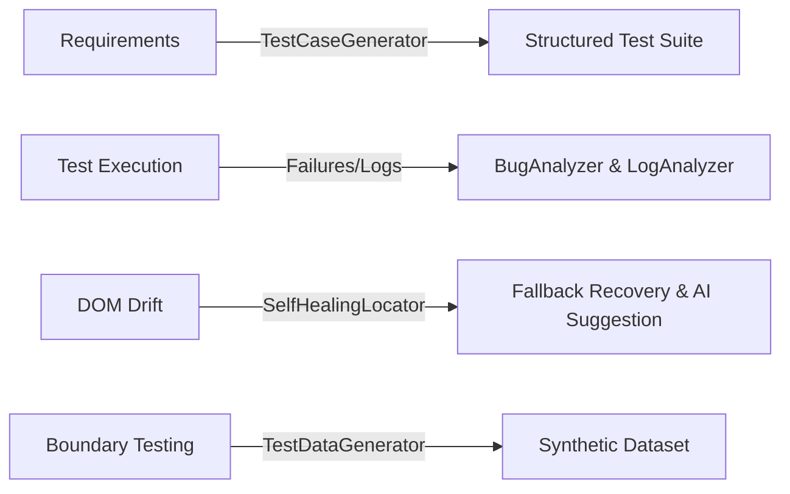

# AI-Assisted QA Capabilities Guide

## Overview
**AI-QA-Suite** introduces five practical AI-augmented capabilities to streamline the QA lifecycle:

## 1. AI Test Case Generation (`ai/test_case_generator/`)
- Ingests software requirements / acceptance criteria.
- Synthesizes structured JSON containing test case ID, title, type (Positive, Negative, Boundary, Edge), priority, preconditions, steps, and expected results.

## 2. AI Bug & Root Cause Analysis (`ai/bug_analyzer/`)
- Ingests defect titles, error messages, and stack traces.
- Suggests probable failure category, severity/priority triage, root cause diagnosis, and targeted developer investigation steps.

## 3. AI Log Stream Analysis (`ai/log_analyzer/`)
- Parses multi-line service log streams.
- Identifies cascading failure chains (e.g. gateway timeouts exhausting database connection pools) and surfaces immediate debugging priorities.

## 4. AI Synthetic Test Data Generation (`ai/test_data_generator/`)
- Synthesizes structured datasets with valid records, boundary cases, and negative test values.

## 5. Self-Healing Locators (`ai/self_healing/`)
- Intercepts selector breakage during UI runs.
- Executes an ordered fallback chain (`primary` ➔ `data-testid` ➔ `role/text` ➔ `XPath`).
- Logs the healing event and queries the AI provider for permanent selector suggestions.
