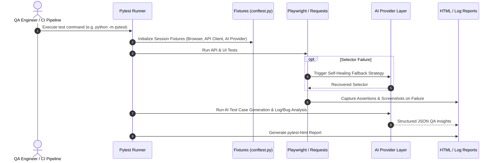

# AI-QA-Suite: Architectural Design & Implementation Guide

## 1. Architectural Philosophy
The **AI-QA-Suite** is engineered on three core pillars:
1. **Separation of Concerns**: Test logic, execution engines, data management, configuration, and AI capabilities are strictly decoupled.
2. **Deterministic Reliability**: AI features enhance QA workflows without compromising the repeatability of test assertions.
3. **Pluggable Architecture**: The system can execute completely offline with zero-cost mock providers or connect seamlessly to state-of-the-art LLMs via environment flags.

---

## 2. Directory Architecture & Responsibilities

### `api/` (API Automation Layer)
- **`clients/api_client.py`**: Low-level session-managed HTTP client wrapping `requests`. Handles base URLs, timing metrics, header masking, and structured request/response logging.
- **`clients/posts_client.py`**: High-level Domain Client encapsulating `/posts` REST operations (`GET`, `POST`, `PUT`, `PATCH`, `DELETE`).
- **`endpoints/routes.py`**: Centralized constant definitions for API URI paths.
- **`models/post_model.py`**: Pydantic models ensuring strong schema validation and type safety.

### `pages/` (UI Page Object Model)
- **`base_page.py`**: Foundational class wrapping Playwright `Page` and `Locator` operations with explicit waiting, click/fill methods, and screenshot capture.
- **`login_page.py`**: Encapsulates login elements (`#username`, `#password`, `button[type='submit']`, `#flash`), authentication actions, and flash notification extraction.
- **`home_page.py`**: Encapsulates main landing page navigation.

### `ai/` (AI-Assisted QA Engine)
- **`providers/ai_provider.py`**: Abstract Base Class (`AIProvider`) enforcing contracts for `generate_text` and `generate_structured_json`.
- **`providers/mock_provider.py`**: 100% offline, zero-cost intelligence provider synthesizing test cases, bug analyses, log anomalies, and synthetic data.
- **`providers/llm_provider.py`**: OpenAI-compatible REST integration with automatic graceful degradation to `MockAIProvider` if API keys are absent.
- **`test_case_generator/`**: Analyzes acceptance criteria to produce prioritized test suites.
- **`bug_analyzer/`**: Diagnoses defect descriptions and stack traces for root causes and investigation steps.
- **`log_analyzer/`**: Analyzes multi-line log streams to detect cascading failures and service timeouts.
- **`test_data_generator/`**: Synthesizes structured data for boundary testing.
- **`self_healing/`**: Resilient locator execution implementing fallback chains and AI selector suggestions.

### `utils/` (Core Shared Utilities)
- **`config.py`**: Singleton dataclass reading environment variables and `.env` settings.
- **`logger.py`**: Configures console and rotating file logs with timestamp and module markers.
- **`test_data.py`**: Utility to load JSON datasets and text files.
- **`helpers.py`**: Common utilities for payload sanitization, unique ID generation, and random test strings.

---

## 3. Data Flow & Execution Sequence

---

## 4. Self-Healing Mechanism: Realistic Design
In this suite, self-healing is implemented through a practical two-stage strategy:
1. **Deterministic Multi-Strategy Fallback**: Tests define a primary locator and an ordered hierarchy of fallback locators (e.g. `CSS ID` ➔ `data-testid` ➔ `aria-role / text` ➔ `XPath`). If the primary selector drifts during a UI redesign, the runner attempts fallbacks, logs the healing event, and continues without false negatives.
2. **AI Locator Suggestion**: When all deterministic selectors fail, the AI provider analyzes the DOM snippet and error log to recommend new resilient locators for the engineer's review.

This transparent approach avoids ungrounded claims of fully autonomous production healing while providing immediate test resilience.
